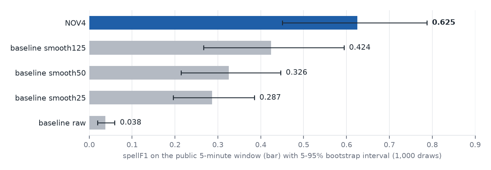
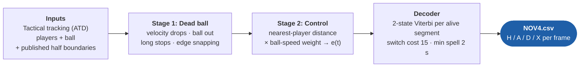
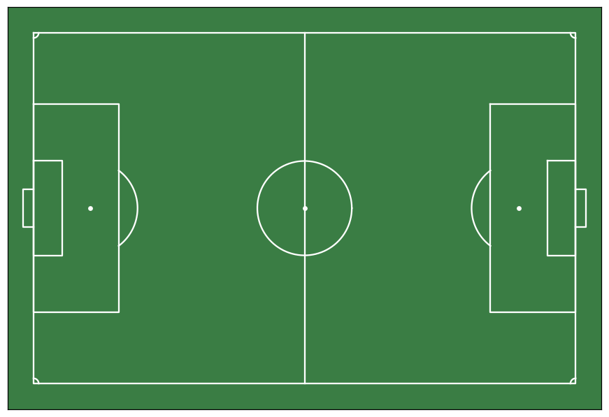
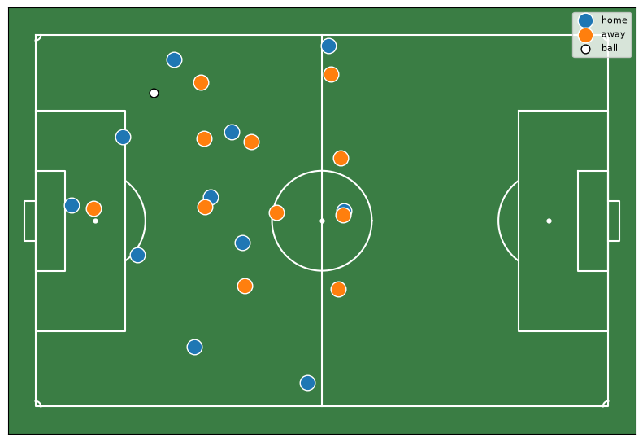

<div align="center">

# ⚽ Ball Possession from Tracking Alone

**Frame-by-frame possession labelling for a full LaLiga match, with no labels and no training data**

*Team **NOV4** · [More than a Hack 2027](https://github.com/metrica-sports/more-than-a-hack-2027) · Phase 1: Ball Possession*
*Organised by [Metrica Sports](https://metrica-sports.com), the [FC Barcelona Innovation Hub](https://www.fcbarcelona.com) and [Mobile World Capital Barcelona](https://www.mwcbarcelona.com)*


**[📄 Technical document (PDF)](docs/NOV4.pdf)** · **[📊 Results](#-results)** · **[🧠 How it works](#-how-it-works)** · **[🚀 Reproduce it](#-reproduce-it)**

</div>

---

## 🎯 The problem

For every one of the **199,319 video frames** of FC Barcelona vs Athletic Club, say who has the
ball: home `H`, away `A` or dead ball `D`.

The catch: the tracking data is **automatic and uncorrected**. Tracks fragment, identities swap,
there are no player IDs, and **the ball is missing on ~41% of graded frames**. Hand labelling is
banned, and no labelled possession data is available. Submissions are ranked on **spellF1**, which
matches whole possessions by temporal overlap, so a one-second flicker `H H A H H` turns one
correct possession into three wrong ones.

## 💡 The approach in one paragraph

A transparent, **rule-based, label-free pipeline** built from football and physical reasoning.
Stage 1 finds dead-ball spans from **collective drops in player speed** and the ball leaving the
pitch. Stage 2 turns the distance from the ball to each team's nearest player into a **per-frame
control signal**. A **two-state Viterbi decoder** with a switch cost and a 2-second minimum spell
turns that signal into stable possessions that don't flicker. Nothing is trained or fitted to
labels.

---

## 📊 Results

<div align="center">



</div>

| Public 5-minute window (7,500 graded frames) | **NOV4** | Best baseline (`smooth125`) |
|---|:---:|:---:|
| **spellF1** (ranking metric) | **0.625** | 0.424 |
| **macroF1** | **0.904** | 0.581 |
| F1 for H / A / D | **0.91 / 0.88 / 0.92** | 0.79 / 0.81 / 0.15 |
| Alive-vs-dead F1 | **0.982** | 0.899 |
| Predicted / true possessions | 15 / 17 | 16 / 17 |

**+47% spellF1** and **+56% macroF1** over the best published baseline, with dead-ball F1 rising
from 0.15 to 0.92.

> [!NOTE]
> **Read this as a check, not a benchmark.** With only 17 possessions the bootstrap intervals are
> wide. The public window was also used to find *which kinds* of stoppage the detector missed, so
> the score is optimistically biased (no constant was tuned on it). The label-free full-match
> diagnostics below are the fairer evidence. See sections 4 and 8 of the
> [technical document](docs/NOV4.pdf).

### What makes the result trustworthy

| | |
|---|---|
| 🔁 **Byte-identical reproduction** | A clean rebuild from raw data gives the same file every time (SHA-256 `6bbbefa3…c954ee7f1930`). Deterministic, no random numbers, `\n` line endings on every OS. |
| ✅ **Validation gate** | The pipeline runs the organisers' official validator on its own output and refuses to finish if it fails. |
| 🧪 **Label-free validation** | The dead-ball detector was checked against automatic set-piece tags with a **permutation test**: 75% of tagged set pieces caught vs 27% by chance (p = 0.0005, 2,000 rotations). |
| 🔬 **Ablation study** | Every dead-ball rule's contribution is measured in isolation (spellF1 0.577 → 0.594 → 0.625). |
| 📏 **Full-match sanity** | 269 possessions, median 11.7 s, ball dead for 26% of graded time, all within plausible football ranges. |
| 🧾 **Stated limitations** | Every known weakness is written down, with the fix I'd try next ([below](#-limitations-and-next-steps)). |

---

## 🧠 How it works



<table>
<tr><td width="33%" valign="top">

### 1 · Dead-ball spans
Mean player speed is divided by the **local tempo** (120 s rolling median), with hysteresis
(enter < 0.6, exit > 0.8). A drop only counts as dead if the ball is also **lost, out, parked or
the stop is long**. A ratio stays fair through frantic spells and tired legs, where a fixed m/s
cut would not. Edges are snapped to the exact moment the ball leaves the pitch or the restart kick.

</td><td width="33%" valign="top">

### 2 · Control evidence
On every frame with a tracked ball:

```text
who     = tanh((d_A − d_H) / 1.5 m)
w_dist  = 1 within 1.5 m, decays beyond
w_speed = 1 up to 7 m/s, 0 at 15 m/s
e(t)    = w_dist · w_speed · who
```

A 50-50 scores near zero, and a ball in flight belongs to nobody.

</td><td width="33%" valign="top">

### 3 · Flicker-free decoding
Viterbi maximises Σ ±e(t) − 15 × switches. A team change needs ~0.3–0.4 s of clear control,
and a brief H→A→H visit needs twice that. Ties switch **late**, so a pass in flight stays with the
passer. Spells under 2 s are absorbed, which is exactly what spellF1 rewards.

</td></tr>
</table>

**Why rules and not a model?** There were no labels to learn from, and the ground truth is derived
mechanically from *corrected* tracking. Reasoning directly about ball position, speed and player
proximity targets the right quantity, and every decision stays explainable.

### Exploration that shaped every decision

Each design choice came out of a specific finding in the data:

| Finding | Decision |
|---|---|
| Ball tracked on only **56.9%** of frames | Long ball gaps are evidence of a dead ball, and the decoder carries possession through blind stretches |
| Player-speed channel labelled "kph" is actually **m/s** (median ratio 1.01 when re-derived from positions) | Use it as-is, and compute ball speed from position with glitch rejection |
| Around set pieces, player speed **dips 36%** (Cohen's d<sub>z</sub> −0.95, z = −5.0 vs open play) | Collective slow-down is a real stoppage signature, so it became the basis of Stage 1 |
| Blind velocity-drop detection catches **corners 12/12, free kicks 5/5**, but misses quick throw-ins | Added a separate fast ball-out-of-play rule |
| A 7-variant threshold sweep left dead-ball recall stuck at 0.48 | The misses were **structural, not a tuning problem**, which led to two targeted rules (recall → 0.89) |
| Smart Tagging intervals are templated 35 s windows | Tags never set a boundary; they are only a ±0.02 prior on ball-less frames |
| Tag-based half boundaries start the 2nd half **114 s late** | Use the organisers' published half boundaries instead |

---

## 🛠️ Tooling built along the way

<details>
<summary><b>Data loader with frame-alignment checks</b> · <a href="src/morethanahack/helpers/loader.py">loader.py</a></summary>

<br>

Wraps [kloppy](https://kloppy.pysport.org) to load the FIFA EPTS tracking data and the Smart
Tagging XML, converting tag times from seconds to video frames so everything sits on the
submission's timeline. Before any heavy load, `check_alignment_raw()` streams frame ids straight
off the raw `.txt` file in seconds and confirms they are contiguous, duplicate-free and match the
video's frame count (199,319 records for 199,319 frames). Helpers handle the off-by-one between
ATD frame ids (from 1) and video frames (from 0).

</details>

<details>
<summary><b>Pitch rendering from the dataset's own metadata</b> · <a href="src/morethanahack/helpers/explorer.py">explorer.py</a></summary>

<br>

`pitch_dimensions()` reads the pitch size and coordinate system (including normalised coordinates
and origin) from the dataset and derives every marking in native units and metres. `plot_pitch()`
draws it either way, so tracking can be overlaid without conversion.



</details>

<details>
<summary><b>Interactive frame-by-frame tracking viewer</b> · <a href="src/morethanahack/helpers/explorer.py">explorer.py</a></summary>

<br>

`FrameViewer` steps through every tracked player (with jersey number) and the ball. It works in a
desktop window and in notebooks / VS Code's Interactive window (via `viewer.next()`,
`viewer.goto(frame_id)`).

| Control | Action |
|---|---|
| slider | scrub to any frame |
| `←` / `→` | one frame back / forward |
| `↑` / `↓`, `shift+←/→` | one second |
| `space` | play / pause in real time |
| `home` / `end` | jump to start / end |



</details>

<details>
<summary><b>Interactive Smart Tagging timeline</b> · <a href="Scripts/02_TaggingDataInsights.py">02_TaggingDataInsights.py</a></summary>

<br>

Every tagged tactical phase and set piece on one zoomable timeline: one row per event type, home
and away lanes, goals as full-height lines, half-time shaded, frames and match minutes on the
axes, with hover details and keyboard navigation.

> No charts or statistics from the Smart Tagging data are published here, because they could be
> used to reconstruct it. Run the script with the data in place to see the timeline.

</details>

---

## ⚠️ Limitations and next steps

- **Transition timing.** Only 35% of possession changes land within ±1 s, and the decoder tends to
  switch ~7 frames early. Next: snap H↔A boundaries to the receiver's first touch, as already done
  for dead-ball edges.
- **The ball is missing on 28% of alive frames.** Turnovers inside those gaps are found late. A
  ball detector on the tactical video could fill them.
- **2-D only.** A slow lofted ball passing over a player can look like control.
- **Shots that go out** are marked dead from the line crossing, not the strike.
- **Hand-set constants, one match.** With labelled data from other games, the next step is to fit
  the emission model and switch cost of a proper HMM and test whether the rules transfer.

---

## 🚀 Reproduce it

Requires [uv](https://docs.astral.sh/uv/) and Python 3.12. Dependencies are pinned in `uv.lock`.
About one minute end to end and ~4 GB RAM.

```bash
git clone --recurse-submodules https://github.com/An-AnD-A/MoreThanAHack.git
cd MoreThanAHack
uv sync --frozen

# Place the tactical data files in data/tactical/ (see "Data and credits"), then:
uv run python Scripts/05_PossessionAssignment.py --refresh             # builds + validates NOV4.csv
uv run python Scripts/06_ScoreSubmission.py --with-baselines --bootstrap 1000   # official scorer
```

The submission is written to `data/derived/possession/submission/NOV4.csv`, alongside
`dead_spans.csv`, `possessions.csv` and a `timeline.png`. Expected SHA-256:
`6bbbefa3813265e853adc5a77411886a4eae140289bf872113d8c954ee7f1930`.

<details>
<summary>Exploration scripts</summary>

```bash
uv run python -m morethanahack.helpers.loader        # alignment checks
uv run python -m morethanahack.helpers.explorer      # metadata, pitch, frame viewer
uv run python Scripts/01_DataExploration.py          # squads, ball visibility
uv run python Scripts/02_TaggingDataInsights.py      # interactive Smart Tagging timeline
uv run python Scripts/03_SetPieceIntensity.py        # set pieces vs player intensity
uv run python Scripts/04_VelocityDropDetection.py    # blind drop detection + permutation test
uv run python Scripts/07_DeadBallExperiments.py      # dead-ball threshold sweep
uv run python docs/source/build_document.py          # rebuild the technical PDF
```

</details>

---

## 📁 Project structure

```text
MoreThanAHack/
├── Scripts/
│   ├── 01_DataExploration.py        # load, check, squads, ball visibility
│   ├── 02_TaggingDataInsights.py    # Smart Tagging timeline (static + interactive)
│   ├── 03_SetPieceIntensity.py      # set pieces vs collective player speed
│   ├── 04_VelocityDropDetection.py  # dead-ball detector + label-free validation
│   ├── 05_PossessionAssignment.py   # ⭐ the model: writes and validates NOV4.csv
│   ├── 06_ScoreSubmission.py        # official validator + scorer, with baselines
│   └── 07_DeadBallExperiments.py    # dead-ball threshold sweep
├── src/morethanahack/helpers/
│   ├── config.py                    # paths, sources, file suffixes, colours
│   ├── loader.py                    # ATD + Smart Tagging loading, alignment checks
│   └── explorer.py                  # metadata, pitch, frame plots, FrameViewer
├── docs/
│   ├── NOV4.pdf                     # technical document
│   ├── source/                      # document source + build script
│   └── images/                      # README figures
├── archive/REPO/                    # official challenge repo (git submodule)
├── data/                            # match data, gitignored, never committed
└── pyproject.toml · uv.lock
```

---

## 👥 Team NOV4

**Anand Anilkumar** · **Anoop Venugopal** · **Shubham Kumar**

---

## 📜 Data and credits

**All match data belongs to its providers and is not included in this repository.**

- **Match:** FC Barcelona vs Athletic Club, LaLiga EA Sports.
- **Data and challenge:** provided by **[Metrica Sports](https://metrica-sports.com)** and the
  **[FC Barcelona Innovation Hub](https://www.fcbarcelona.com)** for *More than a Hack 2027*,
  hosted with the **[Mobile World Capital Barcelona](https://www.mwcbarcelona.com)** at the Talent
  Arena. It includes tactical and broadcast video, automatic tracking (ATD, FIFA EPTS format),
  Smart Tagging and per-frame homography.
- **Official challenge repository:**
  [metrica-sports/more-than-a-hack-2027](https://github.com/metrica-sports/more-than-a-hack-2027)
  (a submodule under [archive/REPO](archive/REPO)), with the task description, data
  documentation, rules, validator and scorer.
- **Licence:** the match data is licensed **for this competition only** and is not redistributed
  here. `data/` and every match-derived export are gitignored. Participants can get the data by
  enrolling at [More than a Hack 2027](https://landing.mobileworldcapital.com/more-than-a-hack-2027).

The figures in this README are visualisations made with this repository's code, not the data
itself.

```bibtex
@misc{mtah2027,
  title  = {More than a Hack 2027: Phase 1 - Ball Possession},
  author = {Metrica Sports and FC Barcelona Innovation Hub},
  year   = {2027},
  url    = {https://github.com/metrica-sports/more-than-a-hack-2027}
}
```

**Built with** [kloppy](https://github.com/PySport/kloppy) (PySport) ·
[pandas](https://pandas.pydata.org) · [NumPy](https://numpy.org) ·
[matplotlib](https://matplotlib.org) · [uv](https://github.com/astral-sh/uv)
