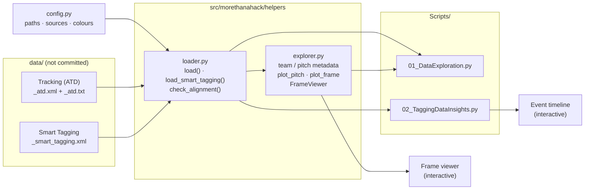

# More than a Hack 2027: Ball Possession

My work for **[More than a Hack 2027 – Phase 1: Ball Possession](https://github.com/metrica-sports/more-than-a-hack-2027)**,
a football data challenge run by [Metrica Sports](https://metrica-sports.com), the
[FC Barcelona Innovation Hub](https://www.fcbarcelona.com) and the
[Mobile World Capital Barcelona](https://www.mwcbarcelona.com).

> **The task:** for every video frame of a full LaLiga match (FC Barcelona vs Athletic Club),
> say who has the ball:
> home `H`, away `A`, dead ball `D`.

This repository holds my own tooling for working with the match data: loading it, checking it,
seeing it and understanding it. I'm building it up to a possession model.

---

## What's been done so far

| Area | Status | Where |
|---|---|---|
| Project setup (uv, Python 3.12, kloppy / pandas / matplotlib) | ✅ done | [pyproject.toml](pyproject.toml) |
| Central config for paths, sources and colours | ✅ done | [config.py](src/morethanahack/helpers/config.py) |
| Tracking data (ATD) loader + frame-alignment checks | ✅ done | [loader.py](src/morethanahack/helpers/loader.py) |
| Smart Tagging loader (seconds → video frames) | ✅ done | [loader.py](src/morethanahack/helpers/loader.py) |
| Team and pitch metadata inspection | ✅ done | [explorer.py](src/morethanahack/helpers/explorer.py) |
| Pitch rendering from the dataset's own dimensions | ✅ done | [explorer.py](src/morethanahack/helpers/explorer.py) |
| Interactive frame-by-frame tracking viewer | ✅ done | [explorer.py](src/morethanahack/helpers/explorer.py) |
| Data exploration script (ball visibility, metadata) | ✅ done | [01_DataExploration.py](Scripts/01_DataExploration.py) |
| Interactive Smart Tagging timeline | ✅ done | [02_TaggingDataInsights.py](Scripts/02_TaggingDataInsights.py) |
| Possession model + submission CSV | 🔜 next | |

### How the pieces fit



---

## 1. Loading the data and checking it lines up

[loader.py](src/morethanahack/helpers/loader.py) wraps [kloppy](https://kloppy.pysport.org) to load
the match:

- **`load(source)`** loads the FIFA EPTS tracking data (players + ball) as a kloppy `TrackingDataset`.
- **`load_smart_tagging(source)`** loads the Smart Tagging XML into a tidy pandas DataFrame, one row
  per tagged event, and adds `start_frame` / `end_frame` columns. It converts the tag times from
  seconds to video frames using the match frame rate, so events sit on the same timeline as the tracking data and
  the submission rows.
- **Frame mapping helpers** `video_frame_of()` / `frame_id_of()` handle the off-by-one between ATD
  frame ids (counted from 1) and video frames / submission rows (counted from 0).
- **Alignment checks.** Every frame-level label depends on the tracking lining up exactly with the
  video, so the loader checks this first. `check_alignment_raw()` streams the frame ids straight
  off the `.txt` file in seconds. A full kloppy load takes minutes, so that one only runs after the
  quick check passes. It confirms the frame ids are contiguous, have no duplicates and match the
  video's frame count.

Run it with `uv run python -m morethanahack.helpers.loader`. Both camera feeds have exactly one tracking record per video frame, with no gaps and no duplicates.

---

## 2. Exploring the tracking data

[explorer.py](src/morethanahack/helpers/explorer.py) handles inspecting and drawing a loaded dataset.

### Pitch from the data, not hard-coded

`pitch_dimensions()` reads the pitch size and coordinate system from the dataset's metadata,
including normalised coordinates and where the origin is. It works out every
marking in both native units and metres. `plot_pitch()` then draws the pitch, either in metres
(true-shaped circles) or in native units, so tracking data can be overlaid without any conversion.


### Frame viewer

`FrameViewer` is an interactive matplotlib tool for stepping through the tracking data by hand. It
shows every tracked player (with jersey number) and the ball on the pitch for a given frame.

| Control | Action |
|---|---|
| slider | scrub to any frame |
| `←` / `→` | one frame back / forward |
| `↑` / `↓`, `shift+←/→` | one second |
| `space` | play / pause in real time |
| `home` / `end` | jump to start / end |

It also works in notebooks and VS Code's Interactive window. There the figure can't take clicks, so
you call `viewer.next()`, `viewer.goto(frame_id)` and similar methods instead.


*A single frame as the viewer draws it. Jersey numbers, the frame number, clock time and the
controls are left out here.*

Also in the module: `team_metadata()` / `print_team_metadata()` (squads, starters, positions),
`frame_positions()`, `plot_frame()` and `animate_frames()`.

### Data exploration script

[01_DataExploration.py](Scripts/01_DataExploration.py) loads the full tactical match, runs the
alignment check, prints both squads and measures **how often the ball is actually tracked**. That
matters because the ball is not tracked on a large share of frames (see the organisers'
[data notes](https://github.com/metrica-sports/more-than-a-hack-2027/blob/main/DATA.md)), so any possession model has to infer
possession through the gaps.

---

## 3. Smart Tagging timeline

The organisers provide **Smart Tagging**: automatically tagged tactical phases and set pieces
(build-up, progression, transitions, set pieces, goals, ball in the box…).
[02_TaggingDataInsights.py](Scripts/02_TaggingDataInsights.py) puts all of them on one timeline:

- one row per event type, with **two lanes per row**: Barcelona (home) on top, Athletic (away)
  below;
- events with no team (e.g. kick-offs) in grey across both lanes;
- **goals** as dashed lines across the whole chart in the scoring team's colour;
- half-time shaded, video frames along the bottom and match minutes along the top.

The interactive version adds a **position** slider to scroll through the match and a **window**
slider to zoom in and out. Hovering over a bar shows its event, team, frame range,
clock time and any extra labels. The `←` / `→` keys step half a window.

> No charts or statistics from the Smart Tagging data are published here, because they could be
> used to reconstruct it. Run the script with the data in place to see the timeline.

These are tactical phases rather than possession labels, so they can't be used as ground truth.
They still say a lot about who is likely on the ball. For example, a `BUILD UP` or `PROGRESSION`
event for a team strongly suggests that team has possession, and the matching
`DEFENDING IN …` event for the other team says the same thing from the opposite side.

---

## Project structure

```text
MoreThanAHack/
├── Scripts/
│   ├── 01_DataExploration.py        # load, check, squads, ball visibility
│   └── 02_TaggingDataInsights.py    # Smart Tagging timeline (static + interactive)
├── src/morethanahack/helpers/
│   ├── config.py                    # paths, sources, file suffixes, colours
│   ├── loader.py                    # ATD + Smart Tagging loading, alignment checks
│   └── explorer.py                  # metadata, pitch, frame plots, FrameViewer
├── docs/images/                     # README figures
├── archive/REPO/                    # official challenge repo (git submodule)
├── data/                            # match data, gitignored, never committed
└── pyproject.toml
```

## Running it

Requires [uv](https://docs.astral.sh/uv/) and Python 3.12+.

```bash
git clone --recurse-submodules <this-repo>
cd MoreThanAHack
uv sync

# Place the match data in data/ (see "Data" below), then:
uv run python -m morethanahack.helpers.loader      # alignment checks
uv run python -m morethanahack.helpers.explorer    # metadata, pitch, frame viewer
uv run python Scripts/01_DataExploration.py
uv run python Scripts/02_TaggingDataInsights.py    # interactive timeline
```

> A full tracking load takes a few minutes and a few GB of RAM. The raw alignment check and the
> Smart Tagging timeline only take seconds.

---

## Data and credits

**All match data belongs to its providers and is not included in this repository.**

- **Match:** FC Barcelona vs Athletic Club, LaLiga EA Sports.
- **Data and challenge:** provided by **[Metrica Sports](https://metrica-sports.com)** and the
  **[FC Barcelona Innovation Hub](https://www.fcbarcelona.com)** for *More than a
  Hack 2027*. The data includes the tactical and broadcast video, automatic tracking (ATD, FIFA EPTS
  format), Smart Tagging and per-frame homography. The event is hosted with the
  **[Mobile World Capital Barcelona](https://www.mwcbarcelona.com)** at the Talent Arena.
- **Official challenge repository:**
  [metrica-sports/more-than-a-hack-2027](https://github.com/metrica-sports/more-than-a-hack-2027)
  (included here as a submodule under [archive/REPO](archive/REPO)). It has the full task
  description, data documentation, rules and scorer.
- **Licence:** the match data is licensed **for this competition only** under the terms accepted
  at enrolment, and is not redistributed here. `data/` is gitignored. Participants can get the
  data by enrolling at
  [More than a Hack 2027](https://landing.mobileworldcapital.com/more-than-a-hack-2027).

The figures in this README are visualisations I made with this repository's code. They are not
the data itself.

If you use the benchmark, please cite it as the organisers ask:

```bibtex
@misc{mtah2027,
  title  = {More than a Hack 2027: Phase 1 - Ball Possession},
  author = {Metrica Sports and FC Barcelona Innovation Hub},
  year   = {2027},
  url    = {https://github.com/metrica-sports/more-than-a-hack-2027}
}
```

### Open-source tools

- [kloppy](https://github.com/PySport/kloppy) (PySport) for loading the EPTS tracking and
  SportsCode / Smart Tagging data
- [pandas](https://pandas.pydata.org), [NumPy](https://numpy.org) and
  [matplotlib](https://matplotlib.org)
- [uv](https://github.com/astral-sh/uv) for environment and dependency management
